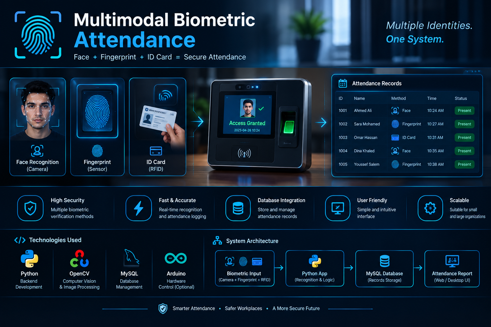

# 👁️🎙️ Multimodal Biometric Attendance System

<p align="center">
  
</p>

<p align="center">
  <strong>AI-Powered Identity Verification & Attendance Tracking</strong>
  <br>
  Facial Recognition • Eye Tracking • Voice Biometrics • Computer Vision
</p>

<p align="center">
  
  
  
  
  
</p>

---

## 🌟 About the Project

The **Multimodal Biometric Attendance System** is an AI-powered application designed to automate attendance tracking through multiple biometric verification methods.

The system combines **facial recognition, eye and liveness tracking, and voice biometrics** to support identity verification and reduce the risk of unauthorized attendance registration.

By integrating computer vision and audio signal processing, the project explores a multimodal approach to authentication and automated attendance management.

## ✨ Key Features

- 👤 **Facial Recognition** — Detects faces and supports identity matching using facial features.
- 👁️ **Eye Tracking & Liveness Detection** — Analyzes eye movement and blink patterns to help detect presentation attacks.
- 🎙️ **Voice Biometrics** — Extracts audio features, including MFCCs, for voice-based identity verification.
- 🔐 **Multimodal Verification** — Combines biometric signals to support more reliable authentication.
- 📊 **Automated Attendance Logging** — Records attendance events with timestamps after successful verification.
- ⚡ **Real-Time Processing** — Designed to process camera and microphone input during authentication.

> **Security note:** Actual recognition accuracy and spoofing resistance depend on the implemented algorithms, trained models, thresholds, and testing results.

## 🛠️ Technology Stack

| Technology | Purpose |
|---|---|
| Python | Core application logic |
| OpenCV | Image processing and computer vision |
| PyTorch | Deep-learning model integration, if implemented |
| Scikit-learn | Machine-learning utilities and classification |
| Librosa | Audio feature extraction |
| NumPy | Numerical operations |
| PyAudio | Microphone input and audio acquisition |

## 🏗️ System Architecture

```text
                 CAMERA & MICROPHONE INPUT
                            |
          +-----------------+-----------------+
          |                 |                 |
          v                 v                 v
   FACE RECOGNITION    EYE / LIVENESS     VOICE BIOMETRICS
   Face Features       Blink / Gaze       MFCC Features
          |                 |                 |
          +-----------------+-----------------+
                            |
                            v
                 MULTIMODAL VERIFICATION
                            |
                  +---------+---------+
                  |                   |
                  v                   v
            Identity Check       Verification Result
                                      |
                                      v
                              ATTENDANCE LOGGING
                                      |
                                      v
                              Timestamped Records
```

## 📂 Project Structure

```text
Multimodal-Biometric-Attendance/
│
├── README.md
├── docs/
│   └── images/
│       └── banner.png
│
├── main.py
├── face_module.py
├── eye_tracker.py
├── voice_module.py
└── requirements.txt
```

*The structure above is a suggested layout. Adjust the filenames to match the actual files in your repository.*

## ⚙️ Installation & Setup

### 1. Prerequisites

- Python 3.8 or later
- A working webcam
- A microphone
- Git

### 2. Clone the Repository

```bash
git clone https://github.com/davidhany10/Multimodal-Biometric-Attendance.git
cd Multimodal-Biometric-Attendance
```

### 3. Create a Virtual Environment

**Windows:**

```bash
python -m venv venv
venv\Scripts\activate
```

**Linux / macOS:**

```bash
python3 -m venv venv
source venv/bin/activate
```

### 4. Install Dependencies

If a `requirements.txt` file exists:

```bash
pip install -r requirements.txt
```

Otherwise, install the core packages:

```bash
pip install opencv-python numpy librosa scikit-learn
```

Install PyTorch and PyAudio separately if they are required by your implementation. Their installation requirements can vary by operating system and Python version.

### 5. Run the Application

```bash
python main.py
```

Ensure that `main.py` exists and that the camera and microphone permissions are enabled.

## 🎯 Project Objectives

- Implement a multimodal biometric verification workflow.
- Explore facial feature extraction and identity matching.
- Analyze eye movement and blink patterns for liveness checks.
- Extract acoustic features from voice samples.
- Automate attendance logging and timestamp generation.
- Evaluate the reliability and limitations of biometric authentication.

## 🧪 Testing & Evaluation

Recommended evaluation criteria include:

- **Face Recognition:** False Acceptance Rate (FAR) and False Rejection Rate (FRR).
- **Liveness Detection:** Detection rate against printed photos and replayed videos.
- **Voice Verification:** Verification accuracy under different noise conditions.
- **Performance:** Average processing and verification time.
- **Attendance Integrity:** Correctness and consistency of timestamped records.

## 🔒 Security Considerations

- Store biometric data securely and restrict access to authorized users.
- Obtain appropriate consent before collecting or processing biometric information.
- Avoid storing raw audio or facial images unless necessary.
- Test for false matches, replay attacks, and environmental limitations.
- Do not treat eye tracking or voice matching alone as proof of identity without validated verification logic.

## 🚀 Future Improvements

- Integrate a persistent database for attendance records.
- Add an administrative dashboard and attendance reports.
- Introduce configurable biometric confidence thresholds.
- Evaluate anti-spoofing models against real-world attack scenarios.
- Add encrypted storage, audit logs, and role-based access control.

## 👨‍💻 Author

**David Hany**

Computer Science & Artificial Intelligence | Cybersecurity

GitHub: [@davidhany10](https://github.com/davidhany10)

---

<p align="center">
  <strong>Smarter Attendance • Secure Verification • Intelligent Automation</strong>
</p>
